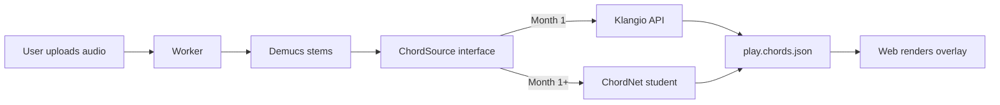
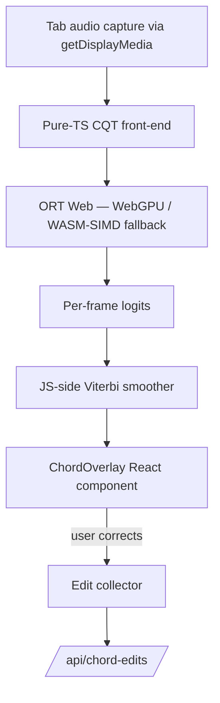
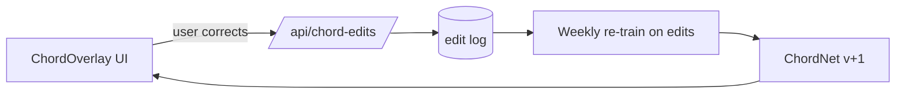
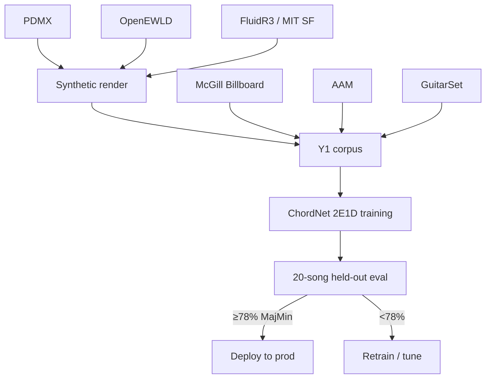

# V3-Y1 Chord Recognition — System Architecture

> **Status:** living document, authored 2026-11-04 against decision record v1.3.
> **Audience:** anyone picking up V3-Y1 cold — a future contributor, or Jon in a month.
> **Scope:** the chord-recognition stack shipped under V3-Phase-2 Year-1. Not the broader V3 product.

**At a glance**

| Field | Value |
|---|---|
| Decision record | `claude/phase-2-y1-chord-model-decision.md` v1.3 (project doc) |
| TSD section | §1.5a chords, §1.6a chord-edit flywheel, §5.4 browser matrix, §9 build order |
| Hard end-date | **2026-12-02** (Y1 stop-clock, H-1 engaged Week-2 Friday) |
| Eval gate | ≥78% MajMin, ≥65% 7ths absolute; within 5% of Klangio ref; 3 shuffle runs; no song <50% |
| Weights license target | Apache-2.0, **conditional on eval pass** |
| PR inventory | #72 Y1.2 · #73 Y1.1 · #74 Y1.3 · #75 Y1.eval-verify · #76 TSD-amendments · #77 Y1.4 · #78 Modal-Setup · #79 Y1.5a |

---

## 1. Executive summary

V3-Y1 ships two user-visible features and one platform capability:

1. **Paid-path P2-6 chord overlay** — uploaded tracks render bar-aligned chord labels alongside the existing stem loops.
2. **Variant Y live chord overlay** — free-tier browser-side chord inference over tab-captured audio (Chrome/Edge only; iOS Safari degrades to "upload a clip" fallback).
3. **Chord-edit flywheel** — user corrections flow back as training data, closing the gap to the commercial reference over 3–6 months.

Delivery is a **hybrid strategy**. Month-1 ships the paid path against the **Klangio** commercial API (license-safe, immediate quality floor). Months 2–4 ship **ChordNet**, an own-trained student model that eventually replaces Klangio for the paid path and powers the free-tier live overlay (which cannot phone home economically). The `ChordSource` interface (PR #73) lets the two co-exist and A/B behind one contract.

This is a **lifestyle business**, not a path to Series A. The build prioritises shipping quality over scale. The flywheel per TSD §1.6a is the moat: once users start correcting labels, the training set accrues value no vendor can match.

The month-1 plan is 4 weeks with an **H-1 stop-clock at Week 2 Friday** — if the eval gate is unreachable, the paid path ships on Klangio permanently and the student becomes a Y2 problem.

## 2. Business framing

- **Lifestyle, not venture.** No investor pressure, no growth milestone extracting perverse decisions. The ship criterion is "does this make the product obviously better for existing users?" — not scale, not TAM.
- **MVP-first.** Klangio buys a quality floor on day one; the own-trained model buys margin and the free-tier live overlay later.
- **Moat is the flywheel.** Per TSD §1.6a: every user chord-edit becomes a labelled frame in the training corpus. A commercial vendor cannot replicate this because they do not see the edit stream.

## 3. System architecture

### 3.1 End-to-end data flow



The `ChordSource` interface (PR #73, `apps/worker/src/worker/chord_source.py`) returns a `ChordResult` of Harte-syntax `ChordSegment`s. Both backends serialise to the same `play.chords.json` artifact and the worker uploads it to R2 at `jobs/<job_id>/play.chords.json` (private bucket). The web overlay reads it via a 5-minute signed URL minted by `GET /api/jobs/<id>/play-chords` (PR-Y1.qa-T4), unchanged regardless of backend.

### 3.2 Browser-side inference (Variant Y)



Everything inside this box runs client-side. There is no server round-trip per frame — critical to the free-tier unit economics. The JS-side Viterbi (PR #79, `apps/web/src/chord/viterbi.ts`) is **both** the production smoother and the H-3 hedge against CRF-export failure.

## 4. Model architecture — ChordNet 2E1D

Lands in PR #77 (`apps/training/model/chordnet_2e1d.py`).

| Stage | Shape / Spec |
|---|---|
| Input | CQT `[B, 1, 144 bins, T frames]` |
| Encoder-1 | 3× Conv1d, dilated (1, 2, 4), GELU, LayerNorm |
| Encoder-2 | 4-layer Transformer, 4 heads, d_model=128 |
| Decoder | BiGRU, 128 hidden, 2 layers |
| Head (default) | Flat 170-class → post-hoc collapse to 60 labels |
| Head (alt) | Structured 4-head: root (13) + triad (5) + bass (13) + has_7th (2) |
| CRF decoder | Optional, opt-in via `--use-crf`; fallback is JS-side Viterbi |
| Params | ~1.3 M |
| Export | int8 ONNX, ~4–6 MB |

The **flat vs structured** head choice is deferred to Exp A (see §7). The CRF is optional because the ONNX exporter pathway for `torchcrf` is brittle on some Opset targets; H-3 means the JS-side Viterbi is already the production smoother regardless.

## 5. Training corpus

Lands in PRs #72 (skeleton, provenance), #73 (eval harness), #74 (synthetic renderer). Full provenance in `apps/training/DATA-PROVENANCE.md`.

| Source | License | Volume | Role |
|---|---|---|---|
| McGill Billboard | CC0-1.0 | 740 labelled songs | Real-audio labels; H-2 audio-source clearance in flight (Burgoyne outreach, see `claude/correspondence/burgoyne-mcgill-billboard-outreach.md`) |
| AAM — Artificial Audio Multitracks | CC-BY-4.0 | 3,000 tracks + audio | Large labelled real corpus |
| GuitarSet | CC-BY-4.0 | 360 recordings | Monophonic baseline |
| Schubert Winterreise | CC-BY-3.0 | 24 songs × 9 performances | Dense-annotation anchor |
| PDMX + OpenEWLD × FluidR3 / MIT soundfonts | CC-BY / MIT / PD | synthetic-render, unbounded | SheetSage2 recipe — scales corpus cheaply |
| FMA filtered | per-track CC | variable | Augmentation / genre diversity |

**Augmentation.** Pitch-shift **−5..+6 semitones** (PR #74), reverb, noise. The ±6 range is asymmetric because −6 and +6 yield the same pitch class — shifting +6 once covers both directions.

**Target volume.** ≥60 hours of CC-licensed audio-with-labels.

## 6. CQT front-end

### 6.1 Plan v1 — current pin (PR #74)

```
sr        = 22050 Hz
hop       = 2048 samples (~93 ms / frame)
fmin      = C1 (32.70 Hz)
bins      = 144 (6 octaves × 24 bins/oct)
bins_oct  = 24
norm      = global z-norm per split
```

Pinned to `apps/training/cqt/cqt-plan.v1.json` and SHA-gated on both the training side (librosa) and the browser side (pure-TS implementation). Parity is a CI gate — a one-bit drift fails the build.

### 6.2 Red-team findings (v2 in flight)

Red-team pre-mortem (`claude/phase-2-y1-chord-model-redteam-alphabet-cqt.md`) flagged three defects that the v2 plan will address:

1. **Global z-norm** biases loud tracks. v2: **per-song z-norm**.
2. **No HPF** lets rumble leak into low CQT bins. v2: **70 Hz HPF before CQT**.
3. **hop=2048** is too coarse for fast changes (~11 FPS). v2: **hop ≤ 1024**.

Plan v2 does not land in Y1 unless Exp A says it is needed to hit the eval gate.

## 7. Alphabet design

60-label extended-Harte: **12 roots × 5 qualities + N (no-chord)**. Current qualities per PR #77: `{maj, min, dim, aug, sus}`.

Red-team flagged a **~18–26% collapse** rate under this alphabet (common seventh and added-sixth chords map to a strictly smaller quality). **Exp A** validates whether the collapse is tolerable.

**Fork decision.** If Exp A verdict is "collapse > 20% on any pop/jazz split", the head factors to **25 × 13** (root × extended quality) and the flat 170-class collapse is replaced by a trained joint. The CRF transition matrix changes shape accordingly. Alphabet normaliser (`apps/training/model/alphabet.py`) is designed so either form round-trips to Harte lossless modulo the collapse.

## 8. Legal readout — Canadian / Vancouver entity

Written against the Dec 2026 state of the law; not legal advice.

- **No TDM exception in Canada.** The UK and EU text/data-mining carve-outs do not apply. Training on uncleared copyrighted audio is a direct infringement risk.
- ***Thomson Reuters v. Ross Intelligence*** (3rd Cir, Sep 2026, affirming the Feb 2025 SJ): training a competitor model on outputs of a commercial product is **not fair use**. Precedent directly argues against distilling Klangio outputs into ChordNet weights.
- **Clean path only.** Corpus = CC0 / CC-BY + synthetic + user chord-edits (with ToS consent). Klangio outputs **never** touch training.
- **Klangio ToS §12.5** explicitly bans training on API outputs. PR #73 enforces this as a code-level invariant (chord-edit API refuses to accept labels tagged `source=klangio`).
- **H-2 open item.** The Klangio API-specific ToS clause capture is pending — the §12.5 version read is from the generic site ToS. Day-1 blocker for M1 ship.

## 9. Hedges

| Hedge | Trigger | Action |
|---|---|---|
| **H-1 stop-clock** | Week 2 Friday eval does not credibly reach 78% MajMin | Ship paid path on Klangio permanently, defer ChordNet to Y2 |
| **H-2 Klangio API ToS** | API-specific ToS capture reveals terms stricter than site ToS | Renegotiate or move to alternative (Chordify API, Essentia on-prem) |
| **H-3 JS-side Viterbi** | CRF export to ONNX fails for the target Opset | Already landed in PR #79; is production decoder regardless |

## 10. Eval gate

Lands in PR #73 (harness) + #75 (20-song manifest + 4/20 verified). See `apps/worker/src/worker/chord_eval.py`.

**Pass criteria (all must hold):**

- MajMin accuracy ≥ **78%** absolute
- 7ths accuracy ≥ **65%** absolute
- Within **5%** of Klangio reference on the held-out set
- **3 shuffle runs** — no song < 50% on any run
- Alphabet-normaliser coverage ≥ **95%** (every ground-truth chord maps to a non-N label)

The 20-song manifest is a hand-curated held-out set spanning pop, rock, jazz, and one intentionally gnarly genre-shift test. 4 of 20 rows are currently verified; the remainder is in flight.

## 11. The flywheel (TSD §1.6a)



- **PR #PR-Y1.7** (pending) ships `/api/chord-edits`.
- Edits are stored with full provenance (user hash, source weights SHA, frame index, before/after label) so re-training can weight them.
- **Target.** Closes the quality gap to Klangio over 3–6 months of real traffic. Breaks even on Klangio per-call costs ~6 months after the flywheel engages.
- **Guardrail.** Edits tagged `source=klangio` are **discarded** at ingestion. Only user-made edits enter training. This is the Klangio §12.5 enforcement point.

## 12. Training pipeline



**Compute.** PR #78 wires Modal L4 GPUs behind `apps/training/modal_app.py`. Per-run cost + billing-cycle doc in `apps/training/MODAL_BILLING.md`.

## 13. Browser deployment

- **Runtime.** ORT Web, WebGPU primary, WASM-SIMD fallback. Model is int8 ONNX, ~4–6 MB.
- **Parity gate.** Adreno 6xx / 750 class (pre-iPhone 15 Android baseline) must pass the same eval set within 1 pp of the server reference. Any wider drift fails the release.
- **iOS Safari.** Smoke test only — WebGPU is not uniformly available. Variant Y degrades to "record a 15-sec clip and upload" on unsupported browsers.
- **Tab capture.** `getDisplayMedia` with audio — Chrome/Edge only. Firefox and Safari are "upload a clip" paths.
- **CQT parity.** The pure-TS CQT (`apps/web/src/chord/cqt/`) is SHA-gated against `cqt-plan.v1.json` from the training repo. The browser cannot drift off-plan without breaking the build.

## 14. Open questions — as of 2026-11-04

1. **Exp A alphabet verdict.** Does the 60-label collapse rate exceed 20% on pop/jazz splits? Fork decision between flat and 25×13 factored.
2. **Klangio API ToS clause (H-2).** Still pending. Day-1 blocker for M1 ship.
3. **McGill Billboard audio sourcing.** Burgoyne outreach in flight; without matched audio the Billboard labels are label-only and we lean harder on synthetic + AAM.
4. **Variant Y iOS Safari behaviour.** WebGPU availability on 17.x is spotty; need to decide fallback UX (clip upload vs. "unavailable on your device").

---

## References

**Project docs (read via the Projects tool, not the filesystem):**

- `claude/phase-2-y1-chord-model-decision.md` v1.3 — canonical decision record
- `claude/phase-2-y1-chord-model-synthesis.md` — synthesis of research
- `claude/phase-2-y1-chord-model-premortem.md` — pre-mortem
- `claude/phase-2-y1-chord-model-redteam-alphabet-cqt.md` — red-team on alphabet + CQT
- `claude/phase-2-y1-chord-model-research-broad.md` — broad research
- `claude/phase-2-y1-chord-model-research-foundations.md` — foundations
- `claude/phase-2-y1-chord-model-research-data.md` — data research
- `claude/phase-2-y1-chord-model-research-rea.md` — reasonable-effort analysis
- `claude/phase-2-y1-chord-model-research-devils-advocate.md` — devil's advocate
- `claude/phase-2-y1-open-questions-recommendations.md` — open questions
- `claude/phase-2-v3-y1-chord-overlay-plan.md` — overlay plan

**In-repo docs (same tree as this file):**

- `docs/architecture/README.md` — index of architecture docs
- `docs/ops/chord-recognition.md` — operational runbook (PR #73)
- `docs/ops/chord-smoothing.md` — Viterbi runbook (PR #79)
- `docs/ops/synthetic-render.md` — synthetic corpus runbook (PR #74)
- `docs/ops/model-training.md` — training runbook (PR #77)
- `apps/training/DATA-PROVENANCE.md` — training-data provenance (PR #72)
- `apps/training/MODAL_SETUP.md`, `apps/training/MODAL_BILLING.md` — compute (PR #78)

**PR inventory — Y1 to date:**

- **#72** PR-Y1.2 — `apps/training/` scaffolding + DATA-PROVENANCE
- **#73** PR-Y1.1 — ChordSource interface + KlangioChordSource + eval harness
- **#74** PR-Y1.3 — synthetic renderer + CQT plan v1 + pitch-shift aug (stacked on #72)
- **#75** PR-Y1.eval-verify — 4/20 eval rows verified (stacked on #73)
- **#76** PR-TSD-amendments — TSD v1.3 → v1.4
- **#77** PR-Y1.4 — ChordNet 2E1D + training + eval (stacked on #72)
- **#78** PR-Modal-Setup — `modal_app.py` + billing doc + cost calc
- **#79** PR-Y1.5a — JS-side Viterbi + `alphabet.ts` + `transition.ts` + `smoother.ts`
